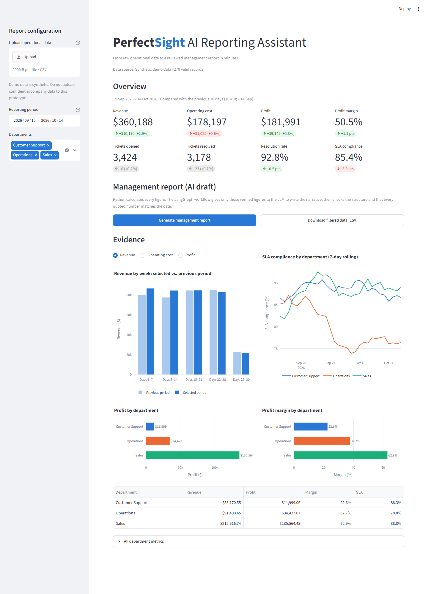

# PerfectSight — AI Reporting Assistant

**Business Analytics, EPM & Data Management prototype**

> Can we turn raw operational data into a reliable, AI-assisted management
> report in minutes instead of preparing it by hand?

A Streamlit dashboard that ingests operational CSV data, calculates KPIs
deterministically with Pandas, and uses a LangGraph workflow to have an LLM
write an executive summary that is validated before it reaches the user.



*All data shown is synthetic.*

## Problem

Internal reporting is repetitive: export data, reconcile totals, build the
same tables, then write a narrative from scratch every period. The numbers
are the slow part to verify, and the narrative is the slow part to write.

## Solution

| Layer | What it does |
| --- | --- |
| **Streamlit UI** | CSV upload, period and department filters, KPI tiles with period-over-period deltas, the AI report directly under the KPIs, then the evidence: weekly current-vs-previous bars, SLA trend, department breakdown |
| **Data layer (Pandas)** | Schema validation, row-level cleaning with a visible count of excluded rows, business-rule checks |
| **Analytics layer (Pandas)** | KPIs, department aggregates, and a comparison with the preceding period of equal length |
| **LangGraph workflow** | `prepare_metrics` → `generate_report` → `validate_report`: one structured LLM call between two deterministic steps, streamed to the UI as live progress |
| **Export** | A Markdown management report that includes the KPI tables, the narrative, and any review flags |

### Key design decision: Python calculates, the LLM explains

The LLM never does arithmetic on raw records. It receives only the verified
KPIs, department aggregates, and period changes, and is asked to explain them,
identify issues, and draft recommendations. Then the validation node:

1. **Checks structure (fails the run).** All four sections are present, the
   lists are lists, and no item is empty.
2. **Checks figures (adds a warning).** Every number quoted in the narrative
   is matched against the calculated metrics, allowing for rounding and
   forms like `$360.2K` or `0.36 million`. Any figure that isn't in the
   evidence is shown to the reviewer as something to verify.

The report card opens with a checklist of these results (for example
"✅ 6 of 6 figures match the calculated data"), so the reviewer sees what was
verified before reading the narrative. The report is a draft for a person
to review, not a finished deliverable.

The dashboard layout follows a recorded design review:
[`docs/design-council.md`](docs/design-council.md).

## Architecture

```
 CSV upload / sample data
          │
          ▼
 ┌──────────────────────┐   reporting/data.py
 │ Validate & clean     │   schema · types · business rules · dropped-row count
 └──────────┬───────────┘
            ▼
 ┌──────────────────────┐   reporting/metrics.py
 │ Deterministic KPIs   │   totals · margins · SLA · dept aggregates
 │ + period comparison  │   vs. preceding equal-length window
 └──────────┬───────────┘
            ├──────────────────────────────▶ Streamlit dashboard (app.py)
            ▼                                KPI tiles · charts · tables
 ┌──────────────────────┐   reporting/workflow.py (LangGraph)
 │ prepare_metrics      │   package verified figures into the prompt
 │        ▼             │
 │ generate_report      │   ChatOpenAI + Pydantic structured output
 │        ▼             │
 │ validate_report      │   structure checks · figure grounding
 └──────────┬───────────┘
            ▼
 ┌──────────────────────┐   reporting/report.py
 │ Report snapshot      │   frozen KPIs + narrative → Markdown export
 └──────────────────────┘
```

Each generated report stores a snapshot of the exact metrics, filters, and
period it was based on. If filters change afterwards, the dashboard flags the
report as stale, and the download still matches the original data.

## Tech stack

Python 3.13 · Streamlit · Pandas · NumPy · Plotly · LangChain · LangGraph ·
OpenAI (via `langchain-openai`) · Pydantic · pytest

## Setup

```bash
git clone https://github.com/JanAli-socool/Reporting-Internal-Audit-Tool.git
cd Reporting-Internal-Audit-Tool

python -m venv .venv
# Windows PowerShell
.venv\Scripts\Activate.ps1
# macOS / Linux
source .venv/bin/activate

pip install -r requirements.txt
```

Configure the LLM (only needed for report generation; the dashboard works
without it):

```bash
cp .env.example .env      # then set OPENAI_API_KEY
```

Run:

```bash
streamlit run app.py
```

The app opens at http://localhost:8501.

### Regenerating the sample data (optional)

`data/sample_operations.csv` is included. To regenerate 90 days ending today:

```bash
python -c "from reporting.data import generate_sample_data; generate_sample_data().to_csv('data/sample_operations.csv', index=False)"
```

The generator is seeded and adds a few deliberate patterns so the report has
something to explain: Sales revenue grows, Customer Support costs rise, and
Operations SLA compliance falls in the last few weeks.

## Using the app

1. The app starts on the synthetic dataset, filtered to the **latest 30 days**,
   so the previous 30 days are available for comparison.
2. Optionally upload a CSV with these columns:
   `date, department, revenue, cost, tickets_opened, tickets_resolved, sla_met`
3. Adjust the reporting period and departments in the sidebar.
4. Review the KPIs, deltas, trends, and department breakdown.
5. Click **Generate management report**.
6. Download the report (Markdown) or the filtered data (CSV).

### CSV rules

| Rule | Behaviour |
| --- | --- |
| Missing required column | Upload rejected with the column names listed |
| Unparseable date, blank department, non-numeric value | Row excluded; the dashboard shows how many |
| No valid rows left | Upload rejected |
| Negative values, fractional ticket counts | Upload rejected |
| `sla_met > tickets_resolved` or `tickets_resolved > tickets_opened` | Upload rejected |

Example files for testing are in `data/examples/`:
`invalid_missing_column.csv` (rejected) and `messy_values.csv` (4 of 10 rows
excluded).

## Tests

```bash
pip install -r requirements-dev.txt
pytest
```

The tests need no API key or network access, because the LLM is replaced by a fake. They cover:

- **Data:** validation of each rejection rule, row exclusion and counting, and that the sample CSV is valid.
- **Metrics:** KPI arithmetic, zero denominators, department aggregates, and period comparison (including when there isn't enough history).
- **Workflow:** a successful run, each missing section, blank items, invented figures flagged, rounded or abbreviated figures accepted, and LLM failure.
- **Export:** the Markdown uses the snapshot period, formats values and changes, and handles a missing comparison.
- **App (headless Streamlit):** loads without a key, shows the missing-key message, filters work, report generation, the stale-report warning after a filter change, graceful LLM failure, and a single-day period.

## Project structure

```
├── app.py                    Streamlit dashboard
├── reporting/
│   ├── data.py               Synthetic data generation, CSV validation
│   ├── metrics.py            KPIs, department aggregates, period comparison
│   ├── workflow.py           LangGraph workflow, prompt, output validation
│   └── report.py             Markdown export from a report snapshot
├── data/
│   ├── sample_operations.csv 90 days × 3 departments (synthetic)
│   └── examples/             Invalid / messy CSVs for testing uploads
├── tests/                    pytest suite (58 tests)
├── docs/                     Screenshots, demo script, design council record
├── .streamlit/config.toml    Theme (primary colour)
├── requirements.txt          Pinned runtime dependencies
└── requirements-dev.txt      + pytest
```

## Limitations

- **Synthetic data:** the figures are illustrative, not real business results.
- **Fixed schema:** one CSV format and one report type.
- **LLM dependency:** narrative generation needs an OpenAI key and network
  access, and incurs API costs (one call per report).
- **Heuristic figure check:** it catches numbers that aren't in the evidence,
  but it can't judge whether a sentence's reasoning is sound. Human review is
  still required.
- **Prototype scope:** no authentication, database, persistence, or
  scheduling.

## Future improvements

- Scheduled report runs delivered by email or Microsoft Teams
- Database / warehouse connectors (SQL Server, PostgreSQL, Snowflake)
- Configurable KPI definitions and targets per department
- Access control and an audit log of generated reports and reviewer sign-off
- Report templates per audience (board, operations, finance)
